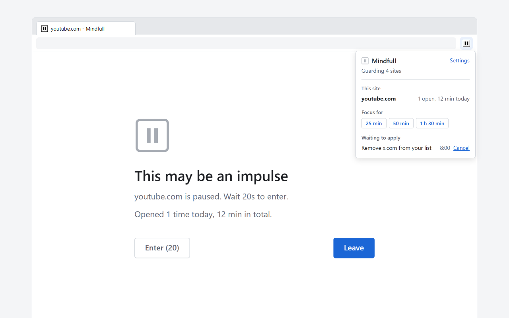
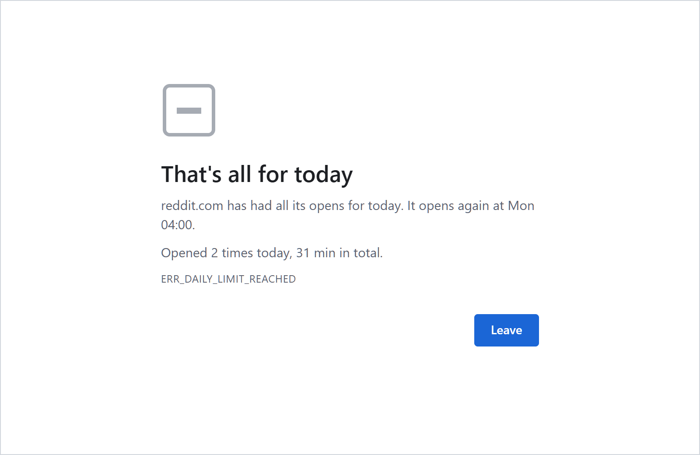
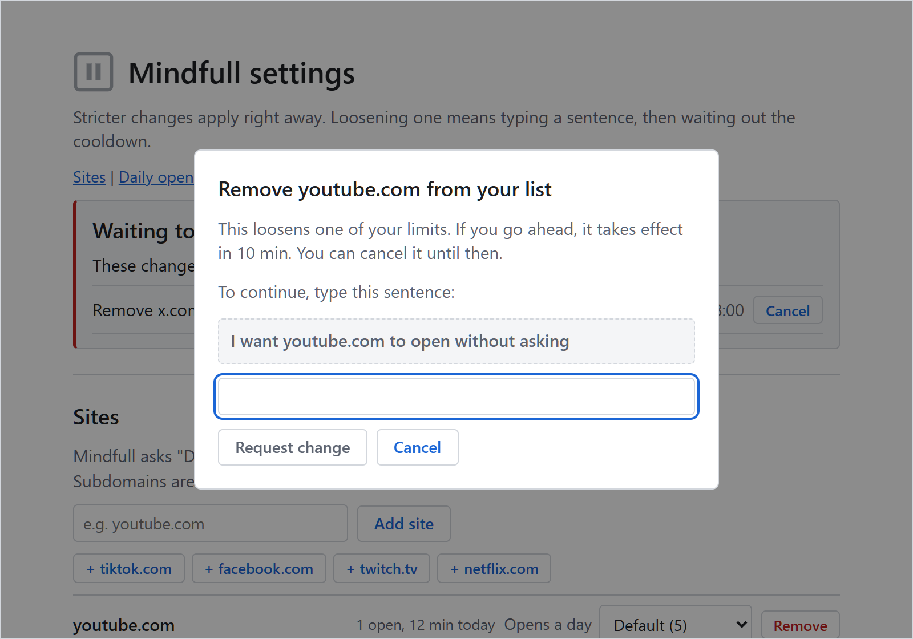
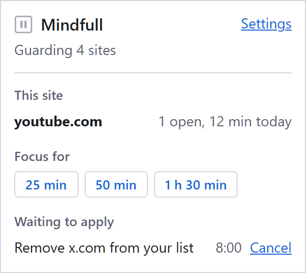
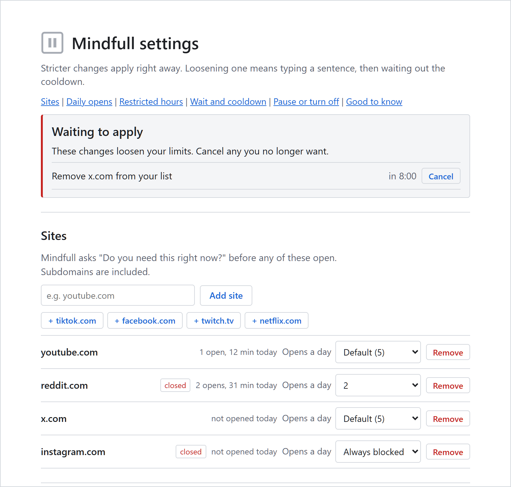

#  Mindfull

A browser extension for Chrome and Firefox that puts a short wait in front of the sites you open on autopilot.



## What it does

When you open a site on your list, Mindfull shows a plain "blocked" page instead. The heading is picked at random each time, e.g. "This may be an impulse", "Is this on purpose?" or "Habit or choice?". The page also shows:

- **Wait 10s to enter.** The Enter button unlocks when the wait is over. The timer pauses while the tab isn't in front of you.
- **Leave** goes back to where you came from, or closes the tab.
- **Enter** asks how long you need (5, 10, 15 or 30 minutes) and then lets you in. When the time is up, the tab comes back to the page ("Time's up").
- **Today's count:** how many times you've opened the site today and how long you've spent on it, e.g. "Opened 3 times today, 24 min in total."

### Daily reset

Everything daily resets at **4 am** local time, not midnight, so scrolling at 1 am still counts toward the evening it belongs to:
- the open count;
- the daily limit;
- the wait, which goes back to the first wait;
- time spent.

Pages left open, such as settings or a "closed until 4 am" page, refresh themselves at 4 am.

### Limits and friction

- **Escalating wait:** each visit to the same site in a day doubles the wait (10s → 20s → 40s …, up to 2 min by default).
- **Daily opens:** how many times a day you can enter each site (default 5, or set per site). Once they're used up, the site is closed until 4 am.
- **Restricted hours:** schedules (e.g. weekdays 9 to 5) when chosen sites are closed, with no Enter button.
- **Focus sessions:** 25, 50 or 90 minutes from the toolbar popup, with every listed site closed.
- **Friction for loosening:** making things stricter applies right away. Loosening needs two steps: first you type a sentence (pasting is blocked), then the change waits out a cooldown (default 10 min) that you can cancel. Loosening means removing a site, raising a limit, shortening the wait, pausing or turning off Mindfull, or ending a focus session early. Removing a site uses a sentence that names it, e.g. "I want youtube.com to open without asking".

<table>
  <tr>
    <td width="50%">
      <picture>
        <source media="(prefers-color-scheme: dark)" srcset="docs/screenshots/closed-dark.png">
        
      </picture>
    </td>
    <td width="50%">
      <picture>
        <source media="(prefers-color-scheme: dark)" srcset="docs/screenshots/confirm-dark.png">
        
      </picture>
    </td>
  </tr>
  <tr>
    <td>Out of opens: closed until 4 am.</td>
    <td>Loosening: type the sentence, then wait out the cooldown.</td>
  </tr>
</table>

### Toolbar popup and settings

The toolbar popup shows the site you're on with today's opens and time, starts focus sessions, and lists changes still waiting out their cooldown, each of which you can cancel. The settings page holds the site list with per-site daily opens, restricted hours, the wait and cooldown, and pausing or turning Mindfull off.

<table>
  <tr>
    <td valign="top">
      <picture>
        <source media="(prefers-color-scheme: dark)" srcset="docs/screenshots/popup-dark.png">
        
      </picture>
    </td>
    <td valign="top">
      <picture>
        <source media="(prefers-color-scheme: dark)" srcset="docs/screenshots/settings-dark.png">
        
      </picture>
    </td>
  </tr>
</table>

### Time spent

Time counts while a listed site is the active tab in a focused browser window. It stops when you switch tabs or apps, and time while the browser is closed or asleep isn't counted.

Everything stays in this browser. Nothing is sent anywhere. Open counts and time spent are kept for 7 days.

### Look

The pause page is styled like a browser's "can't open this site" page, and every page follows your system's light or dark setting. There are no animations or decorations, because the page itself shouldn't be another distraction.

### Changing the wording

The pause-page headings (`IMPULSE_PHRASES`), the remove-site sentences (`REMOVE_SITE_PHRASES`, where `{site}` is filled in) and the general confirmation sentences (`COMMIT_PHRASES`) are all in `src/shared/defaults.js`.

## Install from source

```bash
npm install
npm run build:all
```

- **Chrome:** open `chrome://extensions`, turn on Developer mode, choose **Load unpacked** and pick `dist/chrome`.
- **Firefox:** open `about:debugging#/runtime/this-firefox`, choose **Load Temporary Add-on** and pick `dist/firefox/manifest.json`.

To cover private windows, allow Mindfull there from the extension's details page.

## Develop

```bash
npm test               # Jest unit tests (tests/*.test.js)
npm run build:dev      # like build:all, plus 1-minute options for unlocks, cooldown and focus, for manual testing
npm run zip:all        # build + releases/mindfull-<browser>.zip
npm run icons          # regenerate icons/*.png
npm run screenshots    # rebuild, then regenerate docs/screenshots/ and the store images in docs/store/
```

## How it works

- **`src/shared/`** is pure logic with no browser APIs. Every function takes `now`, so it's all unit-tested.
  - `policy.js` (`siteStatus`) decides whether a site is allowed, needs the wait or is closed. Precedence: paused > focus > restricted hours > active unlock > daily limit > wait.
  - `ops.js` defines every settings change as an op.
    - `isLoosening` decides which changes need the sentence and the cooldown.
    - `advance` moves state forward in time: it applies due changes, expires unlocks and prunes old days.
  - `rules.js` turns state into `declarativeNetRequest` redirect rules, one per closed site. The original URL travels in the pause page's hash.
  - `usage.js` does the time-spent bookkeeping.
  - `friction.js` holds the escalating wait and the sentence checks.
  - `time.js` holds the day keys (a day runs 04:00 to 04:00, `DAY_START_HOUR`) and the clock maths.
- **`src/background/`** is the only code that writes storage.
  - `reconcile()` runs on startup, on every alarm (including a 1-minute tick) and after every change. It applies due changes, expires unlocks, syncs the redirect rules, sends tabs that are no longer allowed back to the pause page, credits time spent, and updates alarms and the toolbar badge.
- **`src/pause`, `src/popup` and `src/options`** are the pages. They never write storage: they send messages (`src/shared/messages.js`) and re-render when storage changes.

## Limitations

- An extension can't stop you disabling it from the browser's extensions page. Mindfull's friction only covers changes made inside Mindfull.
- Time spent only counts the focused window's active tab. A video playing in a background window isn't counted.
